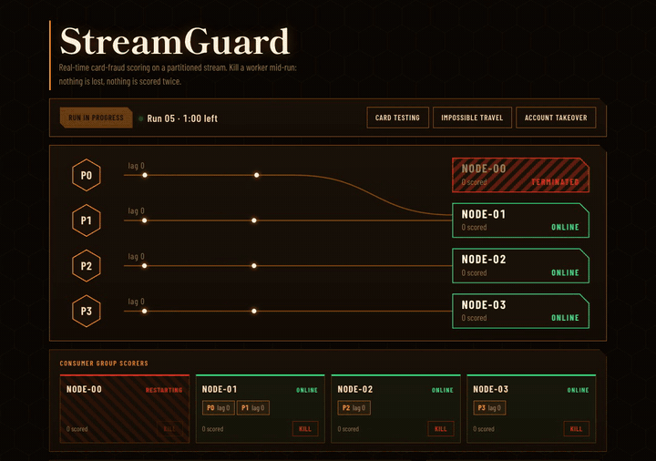
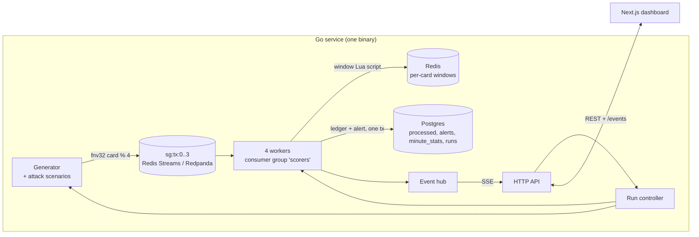

# StreamGuard

Real-time card-fraud scoring over a partitioned event stream, with idempotent consumer-group workers and a live dashboard where you can kill a worker mid-run and watch nothing get lost or scored twice.

**Live demo:** coming soon



## What it shows

- **Consumer groups and partition ownership.** Four workers share one consumer group over four partitions; each partition has exactly one live owner, so a card is never scored concurrently.
- **Rebalancing with ordered reclaim.** Killing a worker hands its partitions to the survivors. The new owner reclaims the dead consumer's pending messages before it reads anything new, so every card's transactions are still scored in order. The worker restarts after 15 seconds and takes its partition back.
- **At-least-once delivery, exactly-once effect.** Messages are acknowledged only after the result is committed; redeliveries are detected by a Postgres ledger and shown as suppressed duplicates.
- **Dead-letter queue.** Messages that cannot be decoded go to `sg:dlq` and are acknowledged, so they never block a partition.
- **Lag and back-pressure.** Per-partition lag is visible on every worker card; a Postgres outage makes workers retry with exponential back-off without acknowledging, so lag grows instead of data disappearing.
- **Five explainable rules.** Velocity, card testing, impossible travel, amount spike and new-merchant-high-amount, each with a human-readable reason on the alert.

## Architecture



| Package | Responsibility |
|---|---|
| `internal/broker` | `Broker` interface, shared contract suite, Redis Streams and Redpanda adapters |
| `internal/gen` | Quiet background traffic over 200 cards plus three attack scenarios |
| `internal/state` | Per-card sliding windows in Redis, written by one idempotent Lua script |
| `internal/rules` | Pure rule functions over a card window; no I/O |
| `internal/scorer` | Partition ownership, worker loop, reclaim, kill and restart |
| `internal/store` | Postgres ledger, alerts, minute stats and run bookkeeping (goose migrations) |
| `internal/run` | The single shared demo run: start, duration, stats, drain, daily cap |
| `internal/httpapi` | REST endpoints, SSE stream, per-IP rate limiter, CORS |

## Engineering notes

### Idempotency

Each message runs `state → rules → record → ack`. `record` is one Postgres transaction: insert the transaction id into `processed` (`ON CONFLICT DO NOTHING`), and only if that inserted a row, write the alert and bump the minute stats. The window write is keyed by transaction id, so replaying it is a no-op. Acknowledgement happens only after the commit and only while the worker is still alive.

| Crash point | What happens |
|---|---|
| Before the Postgres commit | The message is redelivered and scored normally; the window write is idempotent. |
| After the commit, before the ack | The message is redelivered, the ledger insert is a no-op, no second alert is written, and the dashboard shows a suppressed duplicate. |
| Redis error | The run moves to `error`; unacknowledged messages are reclaimed when the next run starts. |
| Postgres error | The worker retries with back-off (100 ms doubling, capped at 5 s) without acknowledging; lag grows. |
| Undecodable message | Sent to the dead-letter stream, then acknowledged. |
| Process restart mid-run | Startup marks the leftover run `abandoned`, so a new run can start immediately, and its pending messages are reclaimed. |

The scorer test suite publishes 1,000 transactions with attack scenarios mixed in, kills a random worker every 50 ms, and asserts that the resulting alert set is identical to a single-worker reference run.

### Ordering across rebalances

A partition is served only by its owner while holding that partition's lock. After a rebalance the new owner drains the previous consumer's pending entries and reads nothing new until that partition has no foreign pending messages left. Rules look only at window entries at or before the transaction's event time, so results are deterministic regardless of which worker scores a message.

### Redis Streams in production, Redpanda locally and in CI

Both brokers sit behind one `Broker` interface and pass the same contract suite (`internal/broker/brokertest`). Production uses Redis Streams because it is available on a free tier without a payment card; the Redpanda adapter shows the design is not tied to Redis and runs in CI with `-tags redpanda`.

### Free-tier budget

Upstash's free tier allows 500K commands a month. A run publishes 5 transactions a second for 3 minutes, acknowledges in batches, backs off when partitions are idle and computes lag in process (published minus acknowledged) rather than polling the broker. That is about 3.3K commands per run; a cap of 4 runs per UTC day keeps the month under the quota. Nothing touches Redis while no run is active.

### Single-instance shortcut

Ownership and kill/restart state live in the coordinator's memory because the demo runs one instance. Scaling out would move partition ownership to Redis leases with fencing tokens; the broker contract and the idempotent ledger already tolerate multiple processes.

## Run it locally

Requires Go 1.27, Node 24 and Docker.

```bash
docker compose up -d --wait                      # Postgres :5435, Redis :6381

cd api && cp .env.example .env
set -a && . ./.env && set +a
go run ./cmd/streamguard                         # API on :8200

cd ../web && cp .env.example .env.local
npm install && npm run dev                       # dashboard on http://localhost:3200
```

Redpanda mode:

```bash
docker compose --profile redpanda up -d --wait
BROKER=redpanda go run ./cmd/streamguard
```

Tests:

```bash
cd api && go test -race ./internal/...           # needs Postgres + Redis from compose
go test -race -tags redpanda ./internal/broker/redpanda/
cd ../web && npm test && npm run e2e
```

## API

All errors use `{"error": {"code": "...", "message": "..."}}`.

| Method and path | Behaviour |
|---|---|
| `GET /events` | Server-sent events. A `snapshot` first (run, workers, last 50 alerts, stats), then live events; keep-alive every 15 s |
| `POST /runs` | Starts a 3-minute run. `409 run_active` (with `ends_at`), `429 daily_cap` |
| `POST /runs/current/scenarios/{name}` | Injects `card_testing`, `impossible_travel` or `account_takeover`. `404 unknown_scenario`, `409 no_run` |
| `POST /runs/current/workers/{id}/kill` | Kills worker 0–3. `409 no_run`, `409 already_down`, `409 last_worker`, `404 unknown_worker` |
| `GET /alerts?cursor=&rule=` | Keyset-paginated alert history, 50 per page |
| `GET /healthz`, `GET /readyz` | Process liveness; readiness also checks Redis and Postgres |

The three `POST` endpoints are limited to 10 requests per minute per IP (`429 rate_limited` with `Retry-After`). CORS allows only the dashboard origin.
